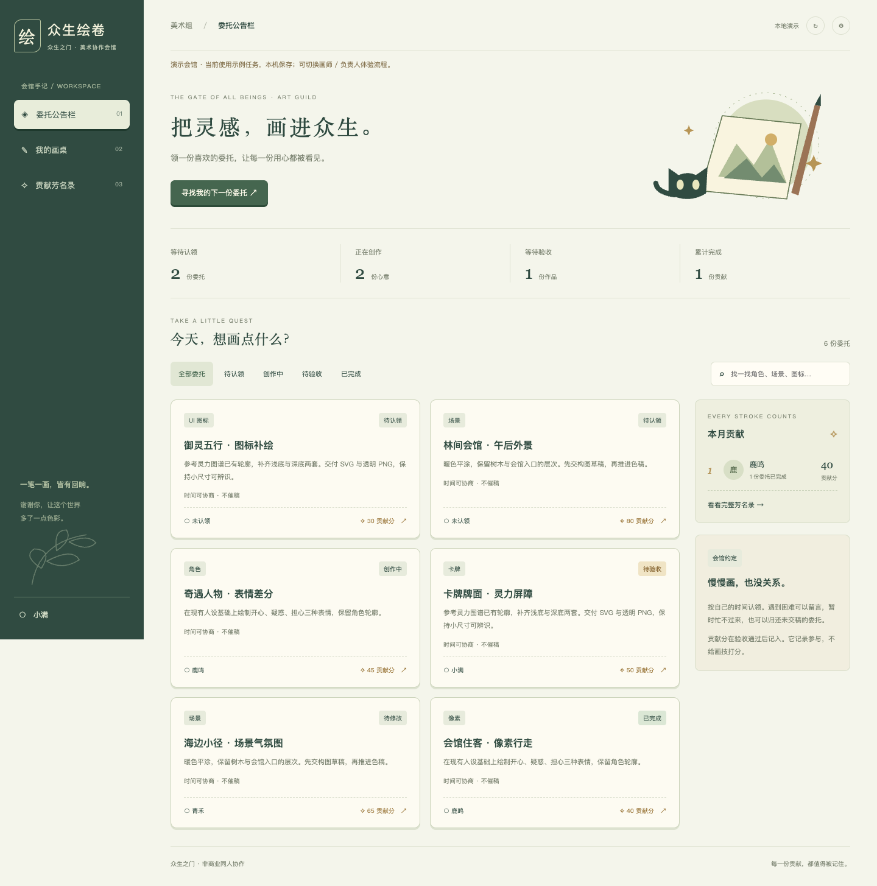
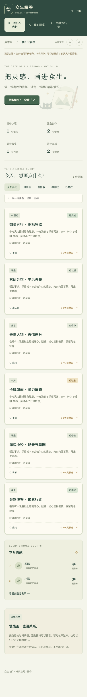
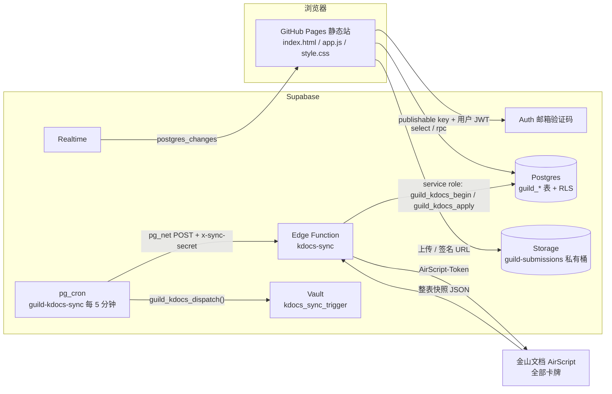
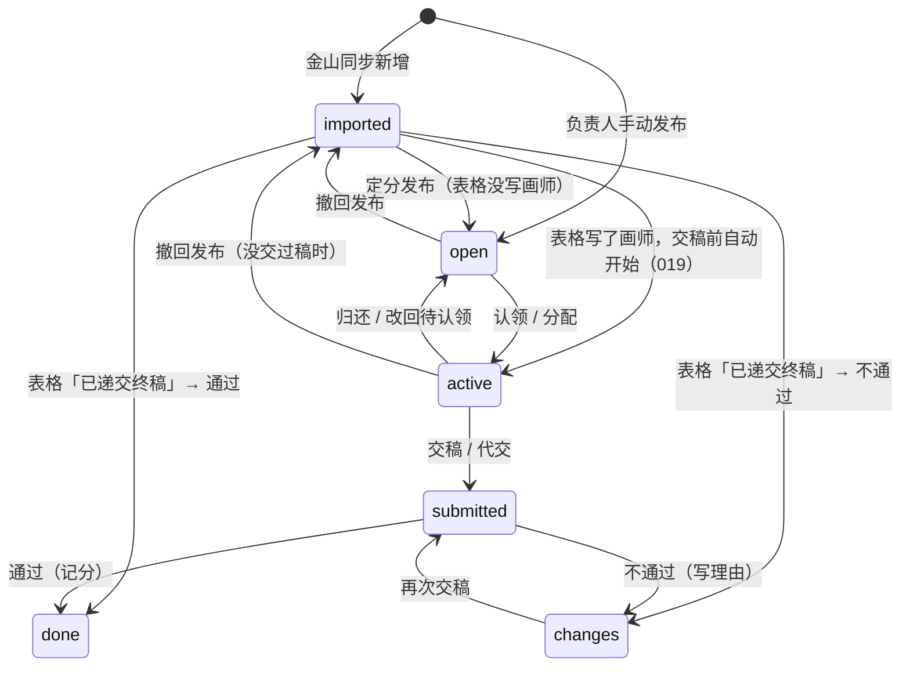

# 众生绘卷 · 美术工单

《众生之门》美术组的任务平台：发任务、认领、交稿、验收、记贡献分，卡牌资料自动跟金山文档同步。

- 网站：<https://aaabby-w.github.io/artist_ranking/>
- 卡牌资料来源：金山文档「全部卡牌」<https://www.kdocs.cn/l/chYu5VON9OzX>
- 后端：Supabase 项目 `jcerhkfttppravatitdx`（Postgres + Auth + Storage + Edge Functions + pg_cron）

| 电脑 | 手机 |
| --- | --- |
|  |  |

---

## 目录

1. [它能做什么](#1-它能做什么)
2. [整体架构](#2-整体架构)
3. [仓库结构](#3-仓库结构)
4. [任务状态与列表规则](#4-任务状态与列表规则)
5. [数据模型](#5-数据模型)
6. [权限模型（RLS / Storage）](#6-权限模型rls--storage)
7. [接口](#7-接口)
   - 7.1 [前端读取的表](#71-前端读取的表)
   - 7.2 [RPC 函数（前端可调用）](#72-rpc-函数前端可调用)
   - 7.3 [内部函数与触发器](#73-内部函数与触发器)
   - 7.4 [Edge Function `kdocs-sync`](#74-edge-function-kdocs-sync)
   - 7.5 [金山 AirScript 返回格式](#75-金山-airscript-返回格式)
   - 7.6 [定时任务 pg_cron](#76-定时任务-pg_cron)
   - 7.7 [Storage 上传路径](#77-storage-上传路径)
   - 7.8 [Realtime 实时更新](#78-realtime-实时更新)
   - 7.9 [登录（Supabase Auth）](#79-登录supabase-auth)
   - 7.10 [作品备份到 GitHub（`artwork-backup`）](#710-作品备份到-githubartwork-backup)
8. [金山文档同步详解](#8-金山文档同步详解)
9. [本地开发与演示模式](#9-本地开发与演示模式)
10. [部署](#10-部署)
11. [测试](#11-测试)
12. [运维手册（常用操作 / SQL）](#12-运维手册常用操作--sql)
13. [数据库迁移清单](#13-数据库迁移清单)
14. [安全约定](#14-安全约定)
15. [已知限制](#15-已知限制)

---

## 1. 它能做什么

### 游客（未登录）
- 浏览任务公告栏：全部 / 待认领 / 创作中 / 待验收，按名称、分类搜索。
- 看稿件展示的署名（作品原图要登录才能看）。
- 看首页公告栏和本期奖励说明。
- 点「认领」或右上角信箱会弹出登录框。

### 画师（已登录且被负责人开通）
- 认领「待认领」任务，或者在「我的画桌」里看到分配给自己的任务。
- 交稿：上传 PNG 图片（≤ 10 MB），或者填作品 / 网盘链接，并写交稿说明。
- 被打回时能看到打回理由，改完再交。
- 归还不想画的任务。
- 金山表里写着自己名字的卡：负责人绑定署名后，会出现在「我的画桌」，可以直接交稿。
- 信箱：新任务发布、验收通过、需要修改、账号连接等通知；置顶本期奖励说明。
- 贡献芳名录：累计榜和本期榜。

### 负责人（admin）
- 负责人工作台：按 待验收 / 待认领 / 创作中 / 待修改 / 已完成 / 待核实 管理全部任务。
- 手动发布任务、编辑和分配还没人认领的任务、删除手动发布且没人碰过的任务。
- 金山表里还没写画师的卡：定分后「发布到待认领」，发错了可以「撤回发布」。
- 待验收只有两个按钮：**通过**（进入稿件展示并记分）和 **不通过**（必须写理由，退回待修改）。
- 帮还没注册的画师代交稿；画师注册后「绑定账号」，名字下的任务和暂存的分数都会转到账号上。
- 给历史稿件补传作品图。
- 画师管理（开通、改昵称）、设置本期起止时间、分值参考表。
- 看金山同步状态；同步被大批量变更拦下时一键确认。

---

## 2. 整体架构



- 前端是**纯静态**文件，没有构建步骤，没有服务器。所有权限都在数据库里用 RLS 和 `SECURITY DEFINER` 函数控制。
- 前端只拿 publishable（anon）公钥；service role 只存在于 Edge Function 运行环境里。
- 金山文档只是**卡牌资料的来源**。认领、交稿、验收、贡献分都只在平台里发生，同步永远不会改写这些。

---

## 3. 仓库结构

```
.
├── index.html                 页面骨架；?v= 参数用来强制刷新缓存
├── app.js                     全部前端逻辑（原生 JS，ES module）
├── style.css                  样式（含手机端两列瀑布流）
├── config.js                  Supabase URL + publishable key（公开的，靠 RLS 保护）
├── assets/fonts/              自托管中文字体（OFL 授权）
├── preview.png / mobile.png   截图
├── supabase/
│   ├── schema.sql             新项目初始化（只在全新项目执行一次）
│   ├── 002_…019_*.sql         增量迁移，按编号顺序执行（见第 13 节）
│   ├── functions/kdocs-sync/  Edge Function：金山同步
│   ├── functions/artwork-backup/ Edge Function：作品备份到 GitHub
│   ├── airscript/sync-cards.js 放在金山文档里的 AirScript 脚本
│   ├── ops/                   只读巡检 SQL 等运维脚本
│   └── templates/             Auth 邮件模板
└── tests/                     本地测试（见第 11 节）
```

---

## 4. 任务状态与列表规则

### 4.1 数据库里的 `guild_tasks.status`

| status | 含义 |
| --- | --- |
| `imported` | 从金山表同步来、还没在平台上正式开始的卡 |
| `open` | 待认领 |
| `active` | 创作中（有画师账号 `assignee`，或者挂在表格名字 `artist_name` 下） |
| `submitted` | 已交稿，待验收 |
| `changes` | 被打回，待修改（`review_note` 存打回理由） |
| `done` | 验收通过，已记分，进入稿件展示 |



### 4.2 页面上的列表

金山表来的卡（`imported`）按表格里的登记进度**并入**平台列表，每张卡只出现在一个列表里：

| 金山表登记 | 页面列表 | 负责人能做什么 |
| --- | --- | --- |
| 负责画师为空 | 待认领 | 定分后「发布到待认领」 |
| 写了负责画师 | 创作中 | 不用发布，不能改作者；直接交稿或代交（019） |
| 完成情况 = 已递交终稿 | 待验收 | 通过 / 不通过 |
| 已从金山表删除 | 不显示（工作台「待核实」里提示） | 在金山表恢复同一行即可重新显示 |

代码位置：`app.js` 的 `sourceState()`、`taskList()`、`matchesTaskFilter()`。

### 4.3 贡献分规则
- 金山表来的卡默认 **20 分**、期望交稿 **2026-11-15**（`guild_kdocs_state.default_points / default_due_date`）。
- 创作开始后分值锁定，不能改。
- 只有验收「通过」才会写入 `guild_awards`，同一任务只记一次（`task_id` 唯一）。
- 画师还没注册时，分数先按表格名字挂着（`guild_awards.artist_id` 为空、`artist_name` 有值），绑定账号后自动转到账号上。
- 本期榜按**最终通过版本的提交时间**落在 `guild_campaign.starts_at ~ ends_at` 之间统计；金山表终稿没有网站提交记录，按通过时间算。

---

## 5. 数据模型

所有表都在 `public` schema，前缀 `guild_`，全部开启 RLS。

| 表 | 主要字段 | 说明 |
| --- | --- | --- |
| `guild_profiles` | `id`(=auth.users.id), `name`, `role`(`artist`/`admin`), `active`, `onboarding_done` | 成员；注册时由触发器自动创建，`active=false` 要负责人开通 |
| `guild_tasks` | `title`, `category`, `brief`, `points`, `status`, `assignee`, `artist_name`, `due_date`, `review_note`, `import_key`, `kdocs_card_id`, `source_record`(jsonb), `source_removed_at`, `source_pending`(jsonb) | 任务。`source_*` 是金山表的登记信息 |
| `guild_task_preview` | `id`, `title`, `category`, `brief`, `points`, `status`, `due_date`, `source_state`, `artist_credit` | **给游客看的副本**（普通表，由触发器维护），不含画师账号等敏感字段 |
| `guild_submissions` | `task_id`, `author_id`, `url`, `note`, `feedback`, `created_at` | 每次交稿一条；`feedback` 是负责人反馈 |
| `guild_awards` | `task_id`(唯一), `artist_id`(可空), `artist_name`, `points`, `submission_id` | 贡献分记录；`artist_id` 为空表示暂挂在表格名字下 |
| `guild_campaign` | `id`=1, `name`, `starts_at`, `ends_at`, `reward_amount` | 本期活动（第一期创作奖励，100 元） |
| `guild_notifications` | `recipient`, `task_id`, `title`, `body`, `read_at` | 信箱通知，由触发器写入 |
| `guild_artist_aliases` | `artist_name`(主键), `artist_id`, `confirmed_by` | 金山表署名 ↔ 账号的绑定 |
| `guild_kdocs_cards` | `(sheet_name, card_id)`, `data`, `missing_since` | 金山卡牌镜像；被删的卡只填 `missing_since`（软删除） |
| `guild_kdocs_mirror` | `source_key`, `sheet_name`, `cells` | 原始单元格镜像 |
| `guild_kdocs_runs` | `status`(`running`/`success`/`failed`), `summary`, `error_code`, `started_at`, `finished_at` | 同步日志，保留 90 天 |
| `guild_kdocs_state` | `id`=1, `last_success_at`, `last_run_id`, `task_sheet`, `approved_removals`, `approved_inserts`, `default_points`, `default_due_date` | 同步状态和一次性确认数 |

`guild_tasks.source_record` 的结构（同步写入）：

```json
{
  "system": "灵卡",            // 或 "旧版参考"
  "sheet": "全部卡牌",
  "row": 91,
  "card_id": "legacy-64",      // = K 列「同步ID」
  "artist": "玻璃猫",          // 负责画师
  "status": "已递交终稿",       // 完成情况
  "url": "https://www.kdocs.cn/l/chYu5VON9OzX",
  "synced": { "title": "…", "brief": "…" }
}
```

`brief`（卡牌介绍）由 `guild_kdocs_brief()` 拼成，每个字段一行：`画面效果：…\n角色：…\n技能介绍：…\n卡牌类型：…\n机制简述：…\n效果 / 数值：…\n卡牌消耗（非贡献分）：…`。手机端卡片按行显示，电脑端连成一段。

---

## 6. 权限模型（RLS / Storage）

### 6.1 身份
- `guild_member()`：当前用户是已开通成员（`active=true`）。
- `guild_admin()`：当前用户是已开通的负责人。

### 6.2 表的读写

| 表 | anon（游客） | authenticated |
| --- | --- | --- |
| `guild_task_preview` | 读（不含已从金山表删除的） | 读 |
| `guild_tasks` / `guild_submissions` / `guild_awards` / `guild_campaign` | — | 成员可读 |
| `guild_profiles` | — | 读自己；成员可读全部 |
| `guild_notifications` | — | 只读自己的 |
| `guild_artist_aliases` | — | 负责人读全部，画师读自己的 |
| `guild_kdocs_cards` / `_mirror` / `_runs` / `_state` | — | 成员可读 |

- **前端没有直接写表的权限**，只有 `guild_tasks` 留了一条负责人 insert 策略（历史兼容）。所有写操作都走第 7.2 节的 RPC，函数内部校验身份和状态，并用 `select … for update` 行锁防止并发重复（比如两个人同时认领，只会成功一个）。
- `guild_kdocs_apply` / `guild_kdocs_begin` / `guild_kdocs_project` 只有 `service_role` 能调。

### 6.3 Storage（私有桶 `guild-submissions`）

| 策略 | 操作 | 条件 |
| --- | --- | --- |
| `guild_submission_images_read` | 读 | 已开通成员 |
| `guild_submission_images_upload` | 上传 | 成员，路径第 1 段是自己的 uid，第 2 段是**自己负责**的任务 |
| `guild_submission_images_admin_upload` | 上传 | 负责人，自己的 uid 目录，任务在 创作中 / 待修改（代交） |
| `guild_historical_artwork_upload` | 上传 | 负责人，任务已交稿 / 已完成，或是金山表已递交终稿的卡（补传历史稿） |
| `guild_submission_images_admin_cleanup` | 删除 | 负责人，**只能删所属任务已不存在的文件** |

图片永远不公开；前端用 `createSignedUrls(…, 3600)` 生成 1 小时有效的签名链接来显示。

---

## 7. 接口

前端用 `@supabase/supabase-js`：

```js
const client = supabase.createClient(GUILD_CONFIG.supabaseUrl, GUILD_CONFIG.supabaseKey);
```

### 7.1 前端读取的表

| 场景 | 调用 |
| --- | --- |
| 游客任务列表 | `client.from("guild_task_preview").select("*")` |
| 成员数据 | `client.from("guild_" + t).select("*").order("created_at", { ascending: false })`，`t` ∈ `tasks, profiles, submissions, awards, campaign` |
| 同步状态 | `guild_kdocs_state.select("last_success_at,approved_removals,approved_inserts").maybeSingle()`；`guild_kdocs_runs` 取最新一条 |
| 署名绑定 | `guild_artist_aliases.select("artist_name,artist_id")` |
| 信箱 | `guild_notifications.select("*").order("created_at",{ascending:false}).limit(100)` |

### 7.2 RPC 函数（前端可调用）

调用方式：`await client.rpc("函数名", { 参数 })`，返回 `{ data, error }`。出错时 `error.message` 是给人看的中文提示，前端直接弹出。
以下函数都是 `SECURITY DEFINER`、`search_path=''`，已撤销 `public`/`anon` 的执行权限，只授权给 `authenticated`。

#### 画师 & 通用

| 函数 | 参数 | 返回 | 谁能调 | 作用 |
| --- | --- | --- | --- | --- |
| `guild_action` | `p_task uuid, p_action text, p_url text = null, p_note text = null, p_feedback text = null` | void | 成员（approve/changes 需负责人） | 统一的任务动作，见下表 |
| `guild_start_sheet_card` | `p_task uuid` | void | 负责人，或已绑定该署名的画师本人 | 金山表写了画师的卡 → 转成 `active`（作者按表格，分值/截止日期用默认）。已开始的再调不报错 |
| `guild_set_name` | `p_name text` | void | 登录用户 | 改自己的昵称 |
| `guild_read_notification` | `p_id uuid` | void | 登录用户 | 把自己的一条通知标为已读 |
| `guild_finish_onboarding` | — | void | 登录用户 | 新手引导看完 |

`guild_action` 的 `p_action`：

| p_action | 前置状态 | 结果 | 校验 |
| --- | --- | --- | --- |
| `claim` | `open` | `active`，assignee=自己 | 已被认领会报「任务已被其他人认领，请刷新」 |
| `release` | `active`/`changes` 且是自己的 | `open` | — |
| `submit` | `active`/`changes` 且是自己的 | `submitted`，新增一条 submission | `p_url` 必须 `http(s)://`，≤2048；`p_note` 1–2000 字 |
| `approve` | `submitted` | `done`，写 `guild_awards` | 负责人；不能验收自己的任务；没有画师（账号或表格名字）不能记分 |
| `changes` | `submitted` | `changes`，`review_note`=理由 | 负责人；`p_feedback` 必填 |

#### 负责人

| 函数 | 参数 | 返回 | 作用 |
| --- | --- | --- | --- |
| `guild_save_task` | `p_task uuid\|null, p_title, p_category, p_brief, p_points int, p_due date = null, p_assignee uuid = null` | uuid | 新建（`p_task=null`）或修改**待认领**任务；有 assignee 直接进 `active` |
| `guild_delete_task` | `p_task uuid` | int | 删除手动发布、没人认领、没有贡献分的任务，连同它的交稿；金山表的卡请在金山表删 |
| `guild_activate_import` | `p_task uuid, p_points int, p_assignee uuid = null, p_legacy_confirm bool = false` | void | 金山卡定分发布：表格没写画师 → `open`；写了 → `active`。旧版参考必须 `p_legacy_confirm=true` |
| `guild_unpublish_task` | `p_task uuid` | void | 撤回发布：已发布、还没交稿的金山卡回到 `imported`，分值和截止日期保留 |
| `guild_review_card` | `p_task uuid, p_action 'approve'\|'reject', p_reason text = null` | void | 验收金山表「已递交终稿」的卡。通过 → `done` 并记分（已绑定署名直接记到账号，否则挂在名字下）；不通过 → `changes`，理由必填 |
| `guild_admin_submit` | `p_task uuid, p_url text, p_note text` | void | 代交稿（任务在 `active`/`changes`），说明前自动加「负责人代交：」 |
| `guild_attach_artwork` | `p_task uuid, p_url text, p_note text` | void | 给已交稿/已完成/金山终稿补传历史作品，不改变状态和分数；`p_url` 必须 `https://` |
| `guild_bind_artist` | `p_name text, p_user uuid` | int | 把金山表署名绑定到账号：名下任务转给账号、暂挂的分数补记、写入 `guild_artist_aliases`。已绑定到别人会拒绝 |
| `guild_release_artist_name` | `p_task uuid` | void | 未注册画师的创作中任务改回待认领 |
| `guild_set_member` | `p_user uuid, p_name text, p_active bool` | void | 开通/停用成员、改昵称 |
| `guild_set_campaign` | `p_name text, p_start timestamptz, p_end timestamptz` | void | 设置本期名称和起止时间 |
| `guild_kdocs_approve` | `p_removals int, p_inserts int = null` | void | 同步被大批量变更拦下后，确认**确切数量**；用一次就清除 |
| `guild_kdocs_resolve` | `p_task uuid, p_action 'accept'\|'dismiss'` | void | 已发布任务的名称/说明在金山表被改了：采用（仅待认领任务）或保持原要求 |

### 7.3 内部函数与触发器

| 名称 | 类型 | 作用 |
| --- | --- | --- |
| `guild_new_user` | auth.users 触发器 | 注册时创建 `guild_profiles`（昵称取注册时填的 `artist_name`，默认「新画师」） |
| `guild_sync_task_preview` | guild_tasks 触发器 | 维护游客副本 `guild_task_preview`（含 `source_state`、`artist_credit` 署名） |
| `guild_task_source_state` / `guild_task_credit` | 函数 | 计算游客可见的原表进度、稿件署名 |
| `guild_kdocs_guard_activation` | guild_tasks 触发器 | 已从金山表删除的卡不能被转成任务 |
| `guild_route_artist_alias` | guild_tasks 触发器 | 任务挂在表格名字下、且该名字已绑定账号时，自动转到账号 |
| `guild_task_notification` | guild_tasks 触发器 | 新任务发布、验收通过、需要修改、任务连接到账号时写通知 |
| `guild_welcome_artist` | guild_profiles 触发器 | 新注册发欢迎信 |
| `guild_kdocs_begin` | service_role | 开始一次同步：加锁、把卡住超过 10 分钟的运行判为失败、拒绝重叠运行 |
| `guild_kdocs_apply(p_run, p_sheets)` | service_role | 应用快照：更新镜像、软删除、投射到任务、写日志 |
| `guild_kdocs_project(p_sheet)` | service_role | 把镜像投射到 `guild_tasks` |
| `guild_kdocs_brief(d)` | 函数 | 拼卡牌介绍 |
| `guild_kdocs_dispatch()` | 仅 cron | 从 Vault 取密钥，用 pg_net 调 Edge Function |

### 7.4 Edge Function `kdocs-sync`

```
POST https://jcerhkfttppravatitdx.supabase.co/functions/v1/kdocs-sync
Content-Type: application/json
x-sync-secret: <SYNC_TRIGGER_SECRET>

{}
```

- 部署时**关闭 JWT 校验**（`--no-verify-jwt`），由函数自己用常量时间比较 `x-sync-secret`。密钥长度必须 ≥ 32，否则拒绝所有请求。
- 只接受 `POST`，其他方法返回 `405`。

**环境变量（Supabase Secrets）**

| 名称 | 说明 |
| --- | --- |
| `SYNC_TRIGGER_SECRET` | 调用密钥，和 Vault 里的 `kdocs_sync_trigger` 必须相同 |
| `KDOCS_WEBHOOK_URL` | 金山 AirScript 共享脚本地址，必须以 `https://www.kdocs.cn/api/v3/ide/file/` 开头 |
| `KDOCS_AIRSCRIPT_TOKEN` | 金山脚本令牌（默认 180 天过期） |
| `SUPABASE_URL` / `SUPABASE_SERVICE_ROLE_KEY` | 平台自动注入 |

**响应**

| HTTP | body | 含义 |
| --- | --- | --- |
| 200 | `{ ok: true, run_id, cards, changed, marked_missing, tasks_inserted, tasks_updated, tasks_flagged, tasks_restored, tasks_marked_removed }` | 成功 |
| 401 | `{ error: "Unauthorized" }` | 密钥不对或没配 |
| 405 | `{ error: "Method not allowed" }` | 不是 POST |
| 409 | `{ ok: false, error: "SYNC_ALREADY_RUNNING" }` | 上一次还没跑完 |
| 500 | `{ ok: false, run_id, error: "<错误码>" }` | 失败，**数据库不做任何改动** |

**错误码**（同时写入 `guild_kdocs_runs.error_code`；日志和响应里不会出现表格内容、URL、令牌）

| 错误码 | 原因 / 处理 |
| --- | --- |
| `SOURCE_CONFIG` | `KDOCS_WEBHOOK_URL` 或令牌没配 |
| `SOURCE_HTTP_401` / `SOURCE_HTTP_403` | 金山令牌过期或被换掉 → 在金山重新生成，更新 `KDOCS_AIRSCRIPT_TOKEN` |
| `SOURCE_HTTP_<其他>` | 金山接口异常，下一轮会自动重试 |
| `SOURCE_SCRIPT_FAILED` | AirScript 自己报错（表格正在编辑、同步ID 重复、K 列被占用等） |
| `INVALID_SNAPSHOT` / `INVALID_SHEET` | 快照不完整、版本不对、工作表异常 |
| `INVALID_HEADERS` | 必需表头缺失或重复 |
| `INVALID_CARD_ID` | 有卡没有同步ID、同步ID 重复或卡牌名称为空 |
| `EMPTY_SNAPSHOT` | 读到 0 张卡 → 拒绝，不会当成全部删除 |
| `MASS_REMOVAL_BLOCKED_<n>` | 一次要移除 n 张，超过阈值 → 负责人确认 |
| `MASS_INSERT_BLOCKED_<n>` | 一次要新增 n 张，超过阈值 → 负责人确认 |
| `DATABASE_<code>` | 写库出错 |
| `<阶段>_FAILED` | 其他未知错误（阶段：`CONFIG` / `SOURCE_FETCH` / `VALIDATION` / `DATABASE_APPLY`） |

### 7.5 金山 AirScript 返回格式

脚本 `supabase/airscript/sync-cards.js` 放在金山文档里，以「共享脚本」方式发布。它会：
1. 每 100 行一批读取「全部卡牌」A–K 列；
2. 只给 **K 列「同步ID」为空**的行补一个 ID（这是脚本唯一会写的单元格）；
3. 再读一遍对比，读取期间表格被改过就放弃，绝不返回混合的半成品。

返回（`payload.data.result`）：

```json
{
  "version": 2,
  "complete": true,
  "sheets": [
    {
      "sheet_name": "全部卡牌",
      "complete": true,
      "rows": [ ["第 1 行…"], ["表头行…"], ["数据行…"] ]
    }
  ]
}
```

`normalize.mjs` 按**表头名字**（第 2 行）找列，不依赖列顺序：

| 必需表头 | 用途 |
| --- | --- |
| `同步ID` | 卡牌唯一标识 |
| `卡牌名称` | 任务标题 |
| `谁的卡` | 角色 |
| `技能介绍` | 介绍 |
| `负责画师` | 原表画师 |
| `完成情况` | 原表进度（`已递交终稿` 进入待验收） |

可选表头：`卡牌类型`、`机制简述`、`效果/数值`（或 `效果 / 数值`）、`费用`（或 `卡牌消耗`）。A 列作为「画面效果」。

### 7.6 定时任务 pg_cron

| 项 | 值 |
| --- | --- |
| 任务名 | `guild-kdocs-sync` |
| 时间 | `2-59/5 * * * *`（每 5 分钟，错开整点） |
| 命令 | `select public.guild_kdocs_dispatch();` |
| 密钥 | Vault `kdocs_sync_trigger`（与 `SYNC_TRIGGER_SECRET` 相同） |

### 7.7 Storage 上传路径

```
guild-submissions/<上传者 uid>/<任务 id>/<随机 uuid>.png
```

前端交稿时写入 `guild_submissions.url` 的是：

```
https://jcerhkfttppravatitdx.supabase.co/storage/v1/object/authenticated/guild-submissions/<路径>
```

显示时再换成签名 URL。目前只接受 `image/png`，≤ 10 MB（历史上传的 jpg / webp 仍可显示）。

### 7.8 Realtime 实时更新

前端订阅频道 `guild-live`，监听 `guild_tasks / submissions / awards / profiles / campaign / notifications` 的 `postgres_changes`，有变化就重新读取。游客监听 `guild_task_preview`，另外页面可见时每 3 分钟补读一次。窗口重新获得焦点时也会补读。

### 7.9 登录（Supabase Auth）

邮箱验证码登录：`signInWithOtp({ email, options: { data: { artist_name } } })` → `verifyOtp({ email, token, type: "email" })`。注册过的邮箱直接进原账号，不会新建。新账号 `active=false`，要负责人在「画师管理」里开通。

### 7.10 作品备份到 GitHub（`artwork-backup`）

网站上传的作品图（Storage）会被自动复制一份到 GitHub 仓库，按画师分文件夹：

```
artworks/<画师名>/<任务名>_<YYYYMMDD-HHMM 北京时间>_<交稿id前8位>.png
```

- 画师名取任务的画师（账号昵称 → 表格署名），负责人代交的稿也放在画师的文件夹里；没有画师的放 `未署名/`。
- 只备份上传的图片；只填了网盘链接的交稿没有文件，不备份。
- 每 10 分钟一次（pg_cron `guild-artwork-backup`，`4-59/10 * * * *`），每次最多 20 张，**一次提交**（Git Data API：blobs → tree → commit → 更新分支，`force: false`）。
- 结果记在 `guild_artwork_backups`（`done` / `failed`、`repo_path`、`commit_sha`、`error_code`、`attempts`）；失败的下一轮重试，最多 5 次。负责人可读这张表。
- 网站本身仍然只从 Storage 读图，GitHub 只是副本。

```
POST https://jcerhkfttppravatitdx.supabase.co/functions/v1/artwork-backup
x-sync-secret: <SYNC_TRIGGER_SECRET>
→ 200 { ok: true, copied, failed, commit } | { ok: true, copied: 0 }
→ 500 { ok: false, error: "CONFIG" | "DATABASE_PENDING" | "GITHUB_REF" | "GITHUB_HTTP_<status>" | "GITHUB_COMMIT" }
```

| Secret | 说明 |
| --- | --- |
| `GITHUB_ARTWORK_TOKEN` | GitHub fine-grained token：只授权目标仓库，权限 Contents: Read and write |
| `GITHUB_ARTWORK_REPO` | 目标仓库，默认 `aaabby-w/artist_ranking` |
| `GITHUB_ARTWORK_BRANCH` / `GITHUB_ARTWORK_DIR` | 默认 `main` / `artworks` |

数据库接口（只有 service role 能调）：`guild_artwork_pending(p_limit)` 返回待备份的 `submission_id, storage_path, artist, task_title, created_at`；`guild_artwork_mark(p_submission, p_status, p_path, p_commit, p_error)` 记录结果。

---

## 8. 金山文档同步详解

**原则：金山表管卡牌资料，网站管工作流程。同步失败时保留上一次正确的数据。**

1. **识别**：每张卡靠 K 列「同步ID」识别，不靠行号；排序、插行都没关系。不要手动改或复制 K 列（复制会造成重复 ID，同步会停下）。
2. **还没开始的卡**（`imported`）：名称、介绍、类型、负责画师、完成情况都会自动更新。
3. **已经在平台上开始的任务**：只更新 `source_record` 里的登记信息；名称/介绍的改动放进 `source_pending`，显示「资料有更新」，等负责人选择采用（仅待认领任务）或保持原要求。**分值、画师账号、状态、交稿、贡献分永远不会被同步改写。**
4. **删除 = 软删除**：表格里删掉的卡只记 `missing_since` / `source_removed_at`，数据库一行都不删。还没开始的卡对游客隐藏；已开始的任务、作品和分数全部保留，工作台提示「待核实」。在金山表恢复同一行（同步ID 不变）就会重新显示。
5. **保护阈值**（以上一次的有效卡数 N 为基准）：
   - 一次移除 > `max(5, ceil(N × 10%))` 张 → `MASS_REMOVAL_BLOCKED_n`
   - 一次新增 > `max(10, ceil(N × 25%))` 张 → `MASS_INSERT_BLOCKED_n`
   - 负责人在网站同步状态栏点「确认移除/新增 n 张」，或运行 `select guild_kdocs_approve(n);`，下一轮执行。确认只对这个确切数字有效，用一次就清除。
6. **读取不完整、表头不对、空表、ID 重复**一律整体拒绝，零写入。
7. **并发**：同一时间只会有一次同步；卡住超过 10 分钟的运行自动判为失败，不阻塞后续。

---

## 9. 本地开发与演示模式

```bash
python3 -m http.server 4173
# 打开 http://localhost:4173
```

- `config.js` 填好时连接真实 Supabase。
- 想用**演示模式**：把 `config.js` 里的 URL 或 key 清空。演示模式用本机 `localStorage`（键 `art-guild-demo-v1`）保存示例任务，可以切换画师/负责人身份体验流程，不联网、不能上传真实图片。
- 改了 `app.js` / `style.css` 后，记得把 `index.html` 里两处 `?v=…` 改成新值，否则手机浏览器可能一直用旧缓存。

---

## 10. 部署

### 10.1 前端
推送到 `main` 即可，GitHub Pages 自动发布（`pages build and deployment`，约 1 分钟）。

### 10.2 数据库（已有项目）
**不要重跑 `schema.sql`，不要重建数据库。** 只按编号执行还没执行过的增量脚本（第 13 节）。每个脚本都能重复执行，自带 `begin/commit`，结尾注释写了回滚方法。

### 10.3 全新项目（从零搭建）
1. SQL Editor 执行 `supabase/schema.sql`，然后按顺序执行 `002` … `019`（`006` 放到最后，见下）。
2. 填 `config.js`：项目 URL 和 publishable key。**不要**填 service role 或数据库密码。
3. Authentication → URL Configuration：Site URL 和 Redirect URLs 填 Pages 地址（含 `/artist_ranking/` 和结尾斜杠）；配置邮件发送；可用 `supabase/templates/` 里的邮件模板。
4. 登录自己的邮箱，然后把自己设为负责人：
   ```sql
   update public.guild_profiles set role='admin', active=true, name='你的昵称' where id='<你的 auth uid>';
   ```
5. 新建私有 Storage 桶 `guild-submissions`。
6. 金山同步：
   ```bash
   supabase secrets set SYNC_TRIGGER_SECRET=<≥32位随机串> KDOCS_WEBHOOK_URL=<共享脚本地址> KDOCS_AIRSCRIPT_TOKEN=<令牌>
   supabase functions deploy kdocs-sync --no-verify-jwt
   ```
   在 Vault 建 `kdocs_sync_trigger`（与 `SYNC_TRIGGER_SECRET` 同值），手动触发两次、第二次 `changed=0` 后再执行 `006_kdocs_schedule.sql` 开启定时任务。

---

## 11. 测试

| 命令 | 内容 |
| --- | --- |
| `node tests/frontend-filters.test.mjs` | 前端列表、筛选、发布表单、绑定状态、同步状态栏、稿件展示（vm + 假 DOM） |
| `node tests/announcement.test.mjs` | 公告栏收起/关闭/开关同步；「DDL」后必须带「（截止日期）」 |
| `node --experimental-strip-types tests/edge-function.test.mjs` | Edge Function 鉴权、错误码、不泄露敏感信息 |
| `node --experimental-strip-types tests/artwork-backup.test.mjs` | 作品备份：路径命名、一次提交、失败重试、不配令牌不动作 |
| `node tests/kdocs-normalize.mjs` | 快照校验与解析 |
| `node tests/airscript-sync.cjs` | AirScript：>100 行、ID 稳定、重复拒绝 |
| `node tests/kdocs-postgres.test.mjs [codex-normalize.mjs]` | **端到端**：在本地一次性 PostgreSQL 里搭出和生产一样的库，跑 002–020 全部迁移和同步/删除/恢复/拦截/并发/权限/验收/绑定/定时任务场景（88 项） |

端到端测试需要本地 PostgreSQL 16（`PGHOST/PGPORT/PGUSER` 环境变量），会自己建库、跑完删除。

---

## 12. 运维手册（常用操作 / SQL）

```sql
-- 最近 5 次同步
select started_at, status, error_code, summary
from public.guild_kdocs_runs order by started_at desc limit 5;

-- 定时任务是否在跑
select jobname, schedule, active from cron.job where jobname = 'guild-kdocs-sync';
select status, start_time from cron.job_run_details order by start_time desc limit 5;

-- 暂停 / 恢复自动同步（不影响任何数据）
select cron.unschedule('guild-kdocs-sync');
-- 恢复：重新执行 supabase/006_kdocs_schedule.sql

-- 确认一次大批量变更（数字要和错误码里的一致）
select guild_kdocs_approve(70);          -- 移除 70 张
select guild_kdocs_approve(null, 40);    -- 新增 40 张

-- 网站与金山表是否一一对应（应为 0 / 0 / 0）
select
 (select count(*) from (select kdocs_card_id from public.guild_tasks where kdocs_card_id is not null group by 1 having count(*) > 1) x) as dup_ids,
 (select count(*) from public.guild_kdocs_cards c where c.missing_since is null
    and not exists (select 1 from public.guild_tasks t where t.kdocs_card_id = c.card_id and t.source_removed_at is null)) as card_without_task,
 (select count(*) from public.guild_tasks t where t.kdocs_card_id is not null and t.source_removed_at is null
    and not exists (select 1 from public.guild_kdocs_cards c where c.card_id = t.kdocs_card_id and c.missing_since is null)) as task_without_card;

-- 改默认分值 / 截止日期（只影响之后的新卡）
update public.guild_kdocs_state set default_points = 20, default_due_date = '2026-11-15' where id = 1;
```

- 只读巡检：`supabase/ops/00_inspect_readonly.sql`（不写任何数据）。
- **金山令牌过期**：同步状态栏会提示「金山脚本令牌可能已过期」。在金山重新生成令牌 → `supabase secrets set KDOCS_AIRSCRIPT_TOKEN=…`，下一轮自动恢复。先设新值再删旧值，不要先删。

---

## 13. 数据库迁移清单

| 文件 | 内容 |
| --- | --- |
| `schema.sql` | 初始化：成员、任务、交稿、贡献分、`guild_action`、RLS、Realtime（**只在全新项目执行**） |
| `002_import.sql` | 历史卡牌导入：`import_key`、`source_record`、`guild_activate_import` |
| `003_admin_tasks.sql` | 负责人工作台：发布/分配/改任务、成员管理、本期活动 `guild_campaign` |
| `004_kdocs_mirror_permissions.sql` | 金山镜像表权限 |
| `005_kdocs_incremental.sql` | 增量同步：`guild_kdocs_runs / cards / state`、`guild_kdocs_apply` |
| `006_kdocs_schedule.sql` | 每 5 分钟定时同步（pg_cron + pg_net + Vault） |
| `007_kdocs_task_projection.sql` | 投射到任务、软删除、保护阈值、`source_pending`、游客副本 `source_state` |
| `008_admin_delete_task.sql` | 负责人删除任务 |
| `009_admin_delete_with_submissions.sql` | 删除时连同测试交稿和图片 |
| `010_card_default_points_due.sql` | 金山卡默认 20 分、截止 2026-11-15 |
| `011_unregistered_artists_and_proxy_submit.sql` | 未注册画师（`artist_name`）、负责人代交、绑定账号、稿件署名 |
| `012_unpublish_card.sql` | 撤回发布 |
| `013_review_two_buttons.sql` | 待验收两个按钮、打回理由、分数暂挂在名字下 |
| `014_historical_upload_and_signup.sql` | 补传历史稿件、注册时填昵称 |
| `015_artist_notifications.sql` | 信箱通知、新手引导 |
| `016_artist_aliases.sql` | 署名 ↔ 账号绑定表、自动路由触发器 |
| `017_bind_pending_source_artist.sql` | 还没发布的卡也能先绑定署名 |
| `018_review_card_alias_award.sql` | 已绑定署名的终稿通过时，分数直接记到账号 |
| `019_start_sheet_card.sql` | 表格已写画师的卡不用发布，直接交稿 |
| `020_artwork_github_backup.sql` | 作品自动备份到 GitHub（按画师分文件夹）+ 定时任务 |

---

## 14. 安全约定

- `config.js` 里只有 publishable key，它本来就是公开的；数据安全靠 RLS。
- **Service role key、金山令牌、同步密钥只存在 Supabase Secrets / Vault 里**，不能出现在仓库、前端、commit、日志里。
- 不为了测试关闭 RLS，不给 `anon` 写权限，不把作品图片公开给游客。
- 删除一律软删除；同步失败、读到空表、分页异常都不会把记录当成已删除。
- 生产环境里涉及权限、删除、认证、密钥、大批量写入的操作，先确认影响范围再做。
- 不在生产库里造假用户、假贡献、假验收来测试；用本地端到端测试。

---

## 15. 已知限制

- 信箱置顶的奖励说明（日期、金额）写在 `app.js` 的 `REWARD_MAIL` 里，换期时要手动改；右侧奖励卡读的是 `guild_campaign`。
- 本期榜只是暂列，最终名单人工核对，网站不发奖金。
- 金山令牌默认 180 天过期，需要人工续。
- 「旧版参考」的卡仍需负责人确认是否单独绘制后再发布。
- 上传只支持 PNG。
